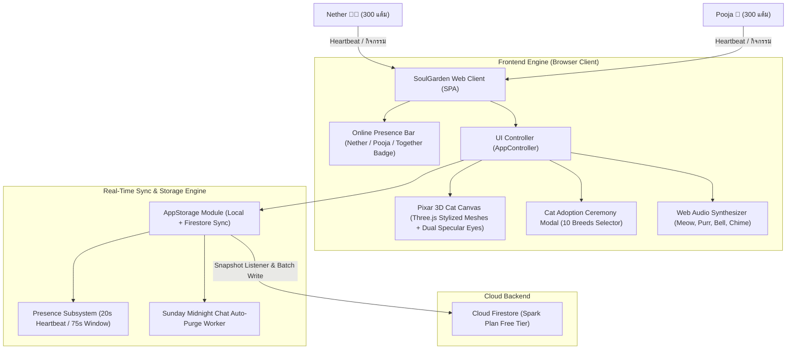
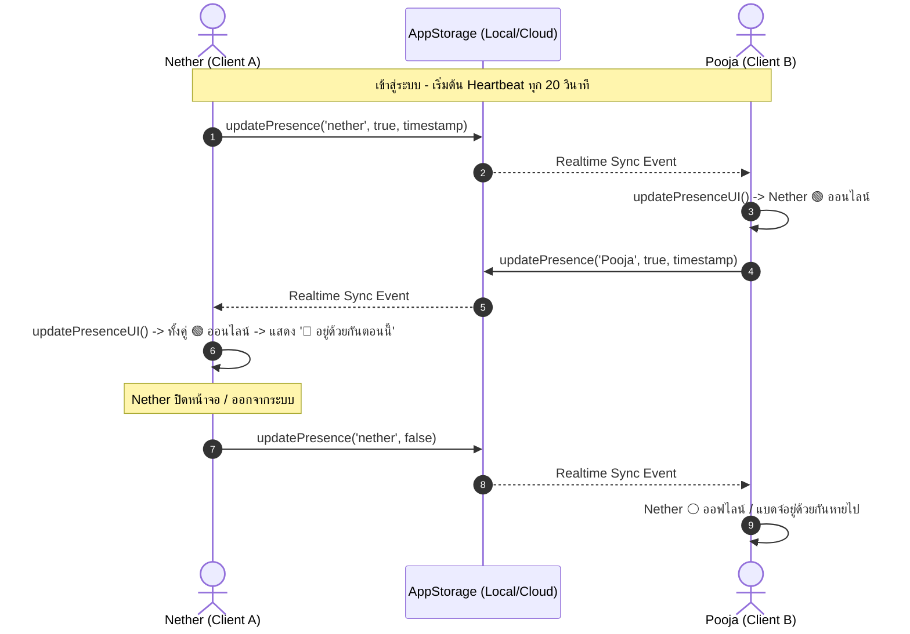

# เอกสารสถาปัตยกรรมและวิศวกรรมระบบ (System Design Document)
**โครงการ:** SoulGarden - สวนใจคู่รักทางไกล (Pixar 3D Cat & Real-Time Presence Edition)  
**เวอร์ชัน:** 3.0.0  
**วันที่ปรับปรุง:** 19 ตุลาคม 2026  
**ผู้จัดทำ:** วิศวกรระบบอาวุโส DeepMind Antigravity  

---

## 1. บทนำและภาพรวมระบบ (Executive Summary & Architecture Overview)

SoulGarden (Pixar 3D Cat & Real-Time Presence Edition) พัฒนาขึ้นเพื่อเป็นสะพานเชื่อมความรักของคู่รักทางไกล (Long-Distance Relationship) โดยยกระดับประสบการณ์ใหม่หมดจด:
1. **Pixar 3D Stylized Cat Design:** ปรับรูปลักษณ์น้องแมว 3 มิติทั้งหมดตามสไตล์อนิเมชัน 3D (หัวโต แก้มป่อง ตาโตสองประกายเงา จมูกชมพู ปากยิ้ม หูมีมิติ และอุ้งเท้า 4 นิ้วกลมมน) รองรับครบทั้ง 10 สายพันธุ์
2. **First Adoption Ceremony (เริ่มต้นแบบยังไม่มีแมว):** ล้างประวัติทั้งหมด เข้าใช้งานครั้งแรกจะยังไม่มีแมวในสวน (`cat: null`) มีเตียงนอนนุ่มรอรับเลี้ยง และเปิดหน้าต่างพิธีรับเลี้ยงแมวตัวแรกให้คู่รักเลือกสายพันธุ์และตั้งชื่อร่วมกัน
3. **Starting Balance 300 Points:** ปรับแต้มเริ่มต้นใหม่เป็นคนละ 300 แต้มเต็ม (`nether: 300`, `Pooja: 300`)
4. **Real-Time Online Presence Indicator:** ระบบตรวจจับและแสดงผลสถานะออนไลน์แบบเรียลไทม์ว่าใครกำลังอยู่ในระบบ พร้อมแบดจ์พิเศษเปล่งประกายเมื่อทั้งคู่เปิดแอปพร้อมกัน (`💖 อยู่ด้วยกันตอนนี้`)
5. **Sunday Midnight Chat Auto-Purge:** ลบประวัติแชทอัตโนมัติทุกเที่ยงคืนวันอาทิตย์เพื่อความเป็นส่วนตัวและประหยัดโควต้า Cloud Firestore Spark Plan ถาวร



---

## 2. การออกแบบรูปลักษณ์น้องแมว 3 มิติสไตล์ Pixar 3D (Pixar 3D Stylized Cat Design System)

ถอดแบบโครงสร้างเรขาคณิตและแสงเงาตามตัวละคร 3D แอนิเมชันคุณภาพสูง:

```
                  /\_/\          /\_/\        <- หูทรงโค้งมน มีโพรงหูด้านในสีชมพูพีช
                 ( o.o )        ( o.o )          (Scottish Fold หูพับ / Sphynx หูใหญ่ค้างคาว)
                (  > ^ <  )    (  > ^ <  )
               /           \  /           \   <- แก้มป่องนุ่มฟู (Cheek Puffs) + หนวด 3 มิติ
              |  (●)   (●)  ||  (●)   (●)  |  <- ตาการ์ตูนโตพิเศษ: ม่านตาสีสวย + รูม่านตาดำใหญ่
              |     ▲       ||     ▲       |     + ดับเบิลประกายตาสะท้อนแสง (Dual Specular Glints)
               \   ╰-╯     /  \   ╰-╯     /   <- จมูกปุ่มสีชมพูกลม + รอยยิ้มโค้งรับแก้ม
                 \  |  /        \  |  /
               (=========)    (=========)     <- ลำตัวทรงลูกแพร์นุ่มนวล พร้อมเอี๊ยมขนหน้าอกสีครีม
               /  |   |  \    /  |   |  \
              (oo) (oo) (oo) (oo) (oo) (oo)   <- อุ้งเท้าแยก 4 นิ้วกลมมนทุกข้าง (Toe Spheres)
                   \~~~~S~~~~~/               <- หางทรงตัว S ดัดโค้งพร้อมลายริ้วข้อหาง
```

### 2.1 องค์ประกอบกายวิภาค 3 มิติ (3D Anatomical Anatomy)
1. **ดวงตาการ์ตูนเปล่งประกาย (Big Expressive Cartoon Eyes):**
   - ตาขาว (Sclera) โค้งมนกว้าง
   - ม่านตาสีประจำสายพันธุ์ (Iris) ความลึก 3 มิติ
   - รูม่านตาสีดำสนิทขนาดใหญ่ (Enlarged Pupil) เพื่อความน่ารักน่าเอ็นดู
   - **ประกายตาสองจุด (Dual Specular Glints):** จุดสว่างใหญ่ด้านบนขวา + จุดสะท้อนแสงนวลด้านล่างซ้าย ให้ตามีชีวิตชีวาเหมือนในแอนิเมชัน
   - เปลือกตากะพริบตาได้ (Blinking Eyelids)
2. **ใบหน้าและปากยิ้ม (Chubby Cheeks & Smiling Muzzle):**
   - แก้มป่อง 2 ข้าง (Spherical Cheek Puffs)
   - แป้นหนวดทรงกลมนูน (Rounded Whisker Pads)
   - จมูกกระดุมสีชมพูพีช (Pink Button Nose)
   - รอยยิ้มโค้งขึ้น (Curved Smile Arc)
   - หนวดแมว 3 มิติข้างละ 3 เส้น ดัดโค้งเป็นธรรมชาติ
3. **ใบหูตามสายพันธุ์ (Upright & Folded Ears):**
   - ฐานหูกว้าง ขอบโค้งมน พร้อมโพรงด้านในสีชมพูพีชนวลตา
   - รองรับลักษณะเด่นเฉพาะสายพันธุ์ (เช่น Scottish Fold หูพับไปด้านหน้า, Maine Coon หูมีพู่ขน Lynx Tuft, Sphynx หูค้างคาวขนาดใหญ่)
4. **ลำตัวและหน้าอก (Pear-Shaped Body & Chest Bib):**
   - ลำตัวทรงลูกแพร์น่ากอด นุ่มนวล ไร้เหลี่ยม
   - หน้าอกและหน้าท้องสีครีมสว่างนวล (Chest Bib) ตัดกับสีขนหลัก
   - ลายริ้วพาดหลัง 3 ริ้วสำหรับสายพันธุ์ลายสลิด (Tabby Stripes)
5. **อุ้งเท้านิ้วกลม (Paws with 4 Rounded Toes):**
   - เท้าทั้ง 4 ข้าง มีปุ่มนิ้วกลมมนข้างละ 4 นิ้วชัดเจนสมจริง
6. **หางดัดโค้งทรงตัว S (Curved S-Tail with Ring Stripes):**
   - หางดัดโค้งเป็นคลื่นรูปตัว S ชี้ขึ้นอย่างมีความสุข พร้อมลายคาดข้อหาง 4 ชั้น

### 2.2 แคตตาล็อกแมวทั้ง 10 สายพันธุ์ (10 Breeds Catalog)

| ลำดับ | รหัสสายพันธุ์ (`breedId`) | ชื่อภาษาไทย | เอกลักษณ์สีขน / ดวงตา | ลักษณะพิเศษ / หู | โบนัสประจำสายพันธุ์ | สี Post-it |
|:---:|:---|:---|:---|:---|:---|:---:|
| 1 | `orange_tabby` | แมวส้มจอมซน | ขนสีส้มอบอุ่น ลายส้มเข้ม ตาอำพัน | แก้มป่อง ยิ้มกว้าง หูตั้งปลายมน | ความอิ่มลดช้าลง 20% | สีส้มพีช |
| 2 | `siamese` | แมววิเชียรมาศ | ครีมงาช้าง แต้มน้ำตาลเข้ม ตาฟ้าสดใส | มาร์กิ้งหน้ากากและปลายหูเข้ม | รับแต้มจากควิซเพิ่ม +10 แต้ม | สีครีมมาร์กิ้ง |
| 3 | `khao_manee` | แมวขาวมณี | ขนขาวบริสุทธิ์นุ่ม **ตาสองสี (ฟ้า/เขียว)** | จมูกชมพูสด โพรงหูชมพู | เช็คอินได้รับโบนัสแต้มพิเศษ | สีขาวมุก |
| 4 | `british_shorthair` | บริติช ช็อตแฮร์ | ขนสีเทาบลูหรูหรา ตาสีส้มทอง | แก้มแน่นกลม ตัวอ้วนกลม | พลังใจผูกพันลดช้าลง 25% | สีเทาบลู |
| 5 | `persian` | เปอร์เซียขนปุย | ขนสีครีมวานิลลาฟูแน่น ตาเขียวมรกต | หน้าสั้นกลม ขนแผงคอหนานุ่ม | ผลิตแต้มสะสมฟรี 15 แต้ม/วัน | สีชมพูพาสเทล |
| 6 | `scottish_fold` | สก็อตติช โฟลด์ | ขนสีไลแลคครีมอ่อน ตาโตกลมบ๊องแบ๊ว | **ใบหูพับโค้งไปข้างหน้า** น่ารัก | เพิ่มโอกาสติดคริติคอลโชคดี | สีม่วงลาเวนเดอร์ |
| 7 | `ragdoll` | แร็กดอลล์ขี้อ้อน | ขนสีขาวครีม ชี้แต้มช็อกโกแลต ตาน้ำเงินไพลิน | ขนแผงคอนุ่ม ขอบตาสวยหรู | ส่งสัญญาณคิดถึงได้แต้ม +5 แต้ม | สีฟ้าเบบี้บลู |
| 8 | `sphynx` | สฟิงซ์ผู้ลึกลับ | ผิวสีชมพูพีชนวลเนียน ตาเขียวมะนาว | **ใบหูค้างคาวขนาดใหญ่ ไร้ขน** | รักษาโรคไวขึ้น ใช้แต้มลดลง 30% | สีทองอำพัน |
| 9 | `maine_coon` | เมนคูนยักษ์ใจดี | ขนสีน้ำตาลช็อกโกแลต ลายเสือ ตาอำพัน | **มีพู่ขนที่ปลายหู (Lynx Tufts)** | ขีดจำกัดความสุขเต็ม 120% | สีน้ำตาลอบอุ่น |
| 10 | `bengal` | เบงกอลเสือดาวน้อย | สีส้มทอง ลายจุดเสือดาว ตาเขียวมรกต | หางหนา ปราดเปรียว ว่องไว | อัตราเติบโตไวขึ้น 1.25 เท่า | สีเหลืองมัสตาร์ด |

---

## 3. สถาปัตยกรรมสถานะเริ่มต้นและการรับเลี้ยงแมว (First Adoption Ceremony)

### 3.1 สถานะก่อนรับเลี้ยง (`cat === null`)
- ฐานข้อมูลเริ่มต้น: ฟิลด์ `cat` มีค่าเป็น `null`
- สวน 3 มิติ: แสดง **"เบาะนอนนุ่มฟูว่างเปล่า (Empty Plush Adoption Bed)"** พร้อมหัวใจลอยคอยต้อนรับ
- หน้าจอแดชบอร์ด: ซ่อนแถบควบคุมดูแลแมว และแสดง **การ์ดต้อนรับรับเลี้ยงแมว (`#adoptionHeroCard`)** เพื่อเชิญชวนให้เริ่มรับเลี้ยง
- ระบบความปลอดภัย: ทุกเมนูที่เข้าถึงแมว (เช่น รายงานตอนเช้า, การให้อาหาร, การแปรงขน) จะมีการตรวจสอบ Guard Clause ป้องกันข้อผิดพลาด `TypeError` 100%

### 3.2 พิธีรับเลี้ยงน้องแมวครั้งแรก (`modalCatAdoption`)
1. ผู้ใช้กดปุ่ม **"เลือกรับเลี้ยงน้องแมวร่วมกัน"** หรือระบบเปิดให้อัตโนมัติเมื่อเข้าสู่ระบบครั้งแรก
2. แสดงแกลเลอรีการ์ด 10 สายพันธุ์ พร้อมตราสัญลักษณ์ คำอธิบาย และโบนัสพิเศษ
3. เมื่อคลิกเลือกสายพันธุ์ ระบบจะแสดง **โมเดล 3D แมวสายพันธุ์นั้นให้ดูตัวอย่างทันทีในฉากหลัง** พร้อมตั้งชื่อเริ่มต้นตามสายพันธุ์
4. ช่องกรอกชื่อแมวสามารถตั้งชื่อตามที่คู่รักต้องการ (เช่น "น้องส้มจี๊ด", "น้องโมจิ")
5. เมื่อกดยืนยัน:
   - เรียกฟังก์ชัน `Storage.adoptCat(breedId, catName, userId)`
   - จุดเอฟเฟกต์พลุเฉลิมฉลอง (Confetti) และเสียงรางวัล
   - บันทึกประวัติใน Activity Audit Trail
   - สลับหน้าสวนเป็นแมวตัวจริงพร้อมปลดล็อกการให้อาหารและการดูแลทันที

---

## 4. ระบบตรวจจับและแสดงผลสถานะออนไลน์เรียลไทม์ (Real-Time Online Presence)



### 4.1 กลไกการทำงานของ Heartbeat
- **ช่วงความถี่ส่งสัญญาณ (Ping Interval):** ทุก 20 วินาที (`startPresenceHeartbeat()`)
- **กรอบเวลาตรวจจับ (Active Window Threshold):** 75 วินาที หาก `Date.now() - lastActive > 75,000 ms` หรือ `online === false` จะถือว่า **ออฟไลน์** ทันที เพื่อป้องกันกรณีปิดเบราว์เซอร์กะทันหัน
- **โครงสร้างข้อมูลสถานะออนไลน์:**
  ```json
  "presence": {
    "nether": {
      "online": true,
      "lastActive": "2026-10-19T14:30:00.000Z"
    },
    "Pooja": {
      "online": true,
      "lastActive": "2026-10-19T14:30:15.000Z"
    }
  }
  ```

### 4.2 ส่วนติดต่อผู้ใช้ (Presence UI Indicators)
- แถบ **`#onlinePresenceBar`** วางอยู่ใต้แถบ Header แสดงตลอดเวลาขณะใช้งาน:
  - ชิปของ Nether: รูปไอคอน + ชื่อ + จุดไฟสถานะ (🟢 สีเขียวมิ้นต์กระพริบเมื่อออนไลน์ / ⚪ สีเทานวลเมื่อออฟไลน์)
  - ชิปของ Pooja: รูปไอคอน + ชื่อ + จุดไฟสถานะ
  - แบดจ์กึ่งกลาง **`#togetherActiveBadge` ("💖 อยู่ด้วยกันตอนนี้")**: จะเปล่งแสงสีชมพูไล่เฉดนีออนเมื่อทั้งสองคนออนไลน์พร้อมกันในระบบ

---

## 5. การปรับปรุงแต้มเริ่มต้นและระบบเศรษฐกิจ (Economy & Starting Balance)

| รายการ | ค่าเดิม (v2.0.0) | ค่าใหม่ (v3.0.0) | วัตถุประสงค์ |
|:---|:---:|:---:|:---|
| แต้มเริ่มต้นของ Nether | 350 แต้ม | **300 แต้ม** | เริ่มต้นใหม่พร้อมกันอย่างเท่าเทียม |
| แต้มเริ่มต้นของ Pooja | 420 แต้ม | **300 แต้ม** | เริ่มต้นใหม่พร้อมกันอย่างเท่าเทียม |
| สถานะแมวเริ่มต้น | มีแมววิเชียรมาศอยู่แล้ว | **ยังไม่มีแมว (`null`)** | ให้คู่รักร่วมพิธีรับเลี้ยงแมวด้วยกัน |
| คลังอาหารเริ่มต้น | มีของ 2–5 ชิ้น | อาหารหลัก 3, ขนม 2, ยา 1, กรรไกร 1 | เพียงพอสำหรับดูแลวันแรกทันที |

---

## 6. สรุปโครงสร้างไฟล์โครงการ (Project File Structure v3.0.0)

```
scratch/lovetree-app/
├── index.html              # หน้าเว็บหลัก SPA พร้อม Online Presence Bar, การ์ดรับเลี้ยง, และ Modal 10 สายพันธุ์
├── css/
│   └── style.css           # สไตล์สไตล์ Modern Glassmorphism, แอนิเมชันจุดออนไลน์, แบดจ์อยู่ด้วยกัน, การ์ดสายพันธุ์
├── js/
│   ├── tree-data.js        # แคตตาล็อกแมว Pixar 3D ทั้ง 10 สายพันธุ์ ข้อมูลสี/หู/ดวงตา/โบนัส ครบถ้วน
│   ├── storage.js          # จัดการข้อมูล v3.0.0, Heartbeat Presence, adoptCat(), รีเซ็ต 300 แต้ม
│   ├── three-garden.js     # เอนจิน 3D Three.js ปรับแต่งเรขาคณิตแมวสไตล์ Pixar 3D, ตาสองประกาย, เตียงรอรับเลี้ยง
│   ├── sound-manager.js    # ซินธิไซเซอร์ Web Audio เสียงแมวเหมียว, เพอร์, กระดิ่ง, และความรัก
│   └── app.js              # ตัวควบคุมหลัก, ดักจับสถานะแมว null, ประสานงาน Heartbeat และพิธีรับเลี้ยง
├── system_design.md        # เอกสารสถาปัตยกรรมระบบฉบับนี้
└── user_manual.md          # คู่มือการใช้งานสำหรับคู่รัก
```
